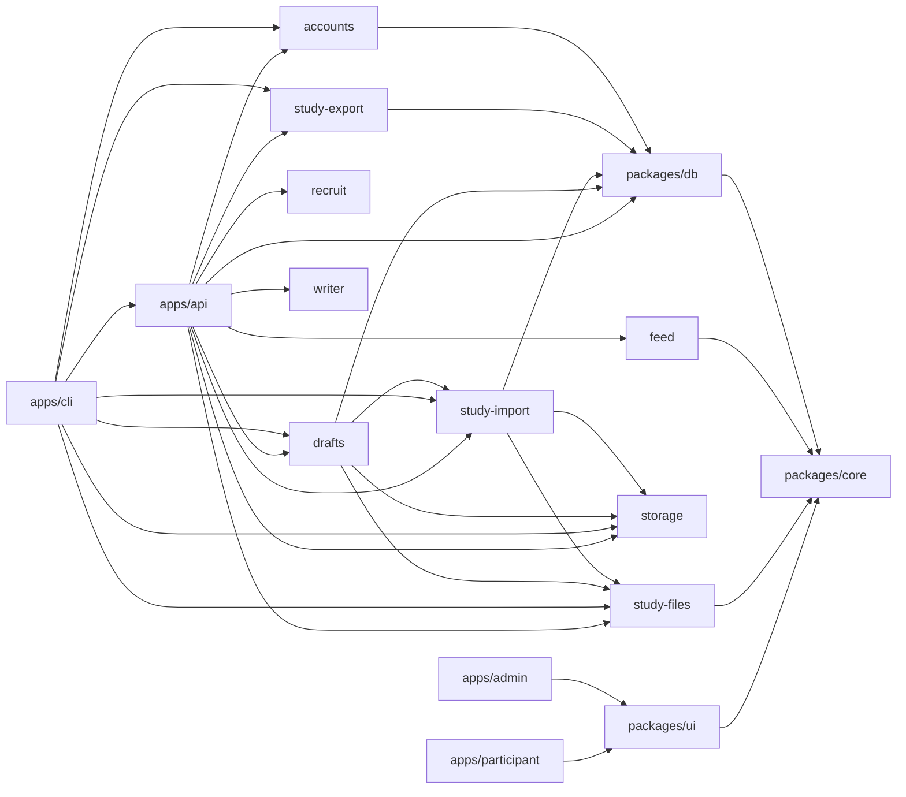

# Architecture

Truman 3 is a monorepo of TypeScript that Node runs directly, with no build step for the server ([ADR 1](adr/0001-typescript-monorepo.md)). This page is the map: what each part is, how they connect, and where to read more. The ADRs in [`adr/`](adr/) say why each choice was made. How staging runs on AWS is in [Cloud architecture](cloud.md).

Truman 3 isn't ready for real participants yet. [Deploying](guides/deploying.md#not-ready-yet) lists what's missing.

## The ideas behind the design

- **A study is data, not a fork.** A study is a definition that can be checked, not its own copy of the code ([ADR 5](adr/0005-studies-as-data.md), [ADR 10](adr/0010-study-design-is-configuration.md)).
- **Everything goes through one API.** Participants, Christof's actors, and researchers all change state through `apps/api`, so everything is checked and recorded the same way.
- **The event log is the source of truth.** What happens in a world is written to an append-only table, and exports come from it ([ADR 6](adr/0006-append-only-event-log.md)).
- **Each participant has their own world,** unless the study shares worlds. Everyone in it apart from them is part of the study's cast ([ADR 67](adr/0067-shared-worlds.md)).
- **Christof, the director, runs the show.** The study decides whether something happens, Christof decides when, and a model only ever writes what's said ([ADR 51](adr/0051-christof-beats-and-the-director.md)).
- **Platforms are built from features.** A template is a set of features with a layout, and a study can turn any of them on or off by condition ([ADR 18](adr/0018-platforms-are-built-from-features.md)).

## The parts

### Apps

| Path               | What it is                                                                                                                                                                                                                                                                                               |
| ------------------ | -------------------------------------------------------------------------------------------------------------------------------------------------------------------------------------------------------------------------------------------------------------------------------------------------------- |
| `apps/api`         | The Hono API ([ADR 3](adr/0003-hono-zod-openapi.md)). The only thing that changes study state. Serves its OpenAPI spec at `/openapi.json`                                                                                                                                                                |
| `apps/participant` | React app participants use: joining, consent and the study's pages, the feed, posts, profiles, spaces, stories, notifications, messages                                                                                                                                                                  |
| `apps/admin`       | React app researchers use, always under `/admin/` ([ADR 21](adr/0021-the-api-has-its-own-login-and-admin-lives-under-a-path.md)): the studies list, the builder, Monitor, and Prolific                                                                                                                   |
| `apps/cli`         | `pnpm study` (validate, test, simulate, import, add-pack, launch, stop, convert, export, withdraw) and `pnpm admin` (setup, add, reset-password, operator, counts)                                                                                                                                       |
| `apps/mcp`         | An MCP server an agent like Claude runs on a researcher's computer, to build and check studies through the admin API with their personal access token ([ADR 64](adr/0064-agents-work-through-tokens-and-an-mcp-server.md)), with the tools in `packages/agent-tools`. See [Agents](guides/for-agents.md) |
| `apps/mobile`      | Truman's phone app for participants: an Expo shell around the participant site, with push notifications ([ADR 66](adr/0066-the-app-is-a-shell-with-push.md)). Its own npm project, outside the workspace                                                                                                 |
| `apps/site`        | The public site at truman-research.org, built with VitePress ([ADR 75](adr/0075-the-public-site.md)): a home page that puts the visitor in a small study, example studies, a guide for researchers, docs for developers, a page for IRBs, and plain-text copies for AI agents                            |

Both web apps are built with Vite ([ADR 2](adr/0002-react-with-vite.md)) into static files. Neither has an address built in. Each one calls `/api` on whatever address it's on.

### Packages

| Path                    | What it is                                                                                                                                            |
| ----------------------- | ----------------------------------------------------------------------------------------------------------------------------------------------------- |
| `packages/agent-tools`  | What an agent can do in Truman, and the guide it reads: used by the MCP server and by "Draft from a brief" ([ADR 65](adr/0065-draft-from-a-brief.md)) |
| `packages/core`         | Shared Zod schemas and types: the study definition and its checks, the event catalog, features and templates, assignment                              |
| `packages/db`           | Postgres through Drizzle ([ADR 4](adr/0004-postgres-and-drizzle.md)): the schema, migrations, `recordEvent`, and the API's database login             |
| `packages/feed`         | What a viewer sees and in what order, as plain functions: rankers, comment orders, and scores                                                         |
| `packages/ui`           | The feed and the page around it, drawn the same way in both apps: features, layouts, and icons                                                        |
| `packages/study-files`  | Reads study folders (CSV and YAML), `beats.yaml`, `scenarios.yaml`, `personas.yaml`, and uploaded sheets. Converts older Truman studies               |
| `packages/study-import` | Freezes a study as a version and stores its media. Launches, stops, and withdraws                                                                     |
| `packages/drafts`       | A study being worked on, saved item by item, with history. Packs and starters                                                                         |
| `packages/study-export` | Writes a study's data as CSVs with a codebook                                                                                                         |
| `packages/storage`      | File storage over S3, so the same code works with local storage and AWS                                                                               |
| `packages/accounts`     | Teams, researcher accounts, and passwords                                                                                                             |
| `packages/recruit`      | Prolific: the API client, encrypted tokens, and approval rules                                                                                        |
| `packages/writer`       | The gateway Christof writes through: Claude through the Anthropic SDK, and a stand-in for tests ([ADR 52](adr/0052-christof-actors-write-live.md))    |

### Other folders

| Path               | What it is                                                                                                                                                                                                                                                                                                                                                                                                       |
| ------------------ | ---------------------------------------------------------------------------------------------------------------------------------------------------------------------------------------------------------------------------------------------------------------------------------------------------------------------------------------------------------------------------------------------------------------- |
| `studies/examples` | The reference studies: `eatsnap` (#1, the classic study converted from `truman_2023`), `bystander` (#2, which uses beats), `flag-source` (#3, who flagged it, from Bhandari et al. 2021), `vaccine-frames` (#4, profile frames and norms, from Aghajari et al. 2024), and `town-talk` (#5, a shared world where civility can spread, inspired by Cheng et al. 2017). `studies/load-test` is for `pnpm load-test` |
| `studies/starters` | Sample content for each template, offered on the New Study page ([ADR 50](adr/0050-sample-content-for-each-kind.md))                                                                                                                                                                                                                                                                                             |
| `e2e`              | Playwright tests: a real browser through the whole example study, and the admin app                                                                                                                                                                                                                                                                                                                              |
| `infra`            | AWS CDK for staging and production. See [Cloud architecture](cloud.md)                                                                                                                                                                                                                                                                                                                                           |
| `scripts`          | The container check, and the script that draws the starters' pictures                                                                                                                                                                                                                                                                                                                                            |
| `compose.yaml`     | Local Postgres and S3-compatible storage                                                                                                                                                                                                                                                                                                                                                                         |
| `Dockerfile`       | The API's image, which also holds the database update and `apps/cli`                                                                                                                                                                                                                                                                                                                                             |

### How they depend on each other

An arrow means "imports". The two web apps import no server code. They reach the API over HTTP.



Most packages also import `packages/core` directly. Those arrows are left out to keep this readable.

`apps/cli` imports `apps/api` only for the scenario runner and simulated participants (`@truman3/api/scenarios`, `@truman3/api/simulate`). `writer`, `recruit`, and `storage` depend on no other package here.

## A request

```
browser ─ /api/... ─▶ apps/api ─▶ packages/db ─▶ Postgres
                          └─────▶ packages/storage ─▶ S3 (or SeaweedFS locally)
```

- **Locally,** each Vite dev server forwards `/api` to the API on port 3000, unchanged. The participant app also forwards `/admin` to the admin app, as a deployment sharing one address would.
- **On AWS,** CloudFront sends `/api/*` to the API. See [Cloud architecture](cloud.md).
- **The API answers under `/api` and at bare paths.** Browsers use `/api/...`. Health checks use `/health` and `/health/ready` ([ADR 19](adr/0019-how-truman-runs-in-production.md)).
- **Routes are built in `createApp`** (`apps/api/src/app.ts`), with what they need passed in: the database, storage, the writer, the clock, and Prolific's settings. Tests pass in their own.
- **Participants and researchers have separate cookies,** `session` and `researcher_session`. Each route reads only its own.
- **Production logs leave out error messages,** since they can hold values from a query. They say what kind of error happened and where (`apps/api/src/errors.ts`, ADR 19).

## Studies

### What a study is

A study definition is checked by `packages/core/src/study/validate.ts`, wherever it came from: a folder, the builder, or a pack.

A study folder has:
- `study.yaml`: settings, conditions, the flow, and pages such as consent
- sheets such as `actors.csv`, `posts.csv`, `comments.csv`, and `reactions.csv`, plus one for each feature that needs it, like `spaces.csv` or `removals.csv`
- `beats.yaml`, `scenarios.yaml`, and `personas.yaml`, if the study uses Christof
- `media/`, for pictures

`pnpm study validate <folder>` checks one. `pnpm study convert` turns an older Truman study into one.

### Drafts, frozen versions, and launching

```
draft (edited item by item) ──save──▶ frozen version ──launch──▶ live: new participants get it
study folder ─────────────import───▶ frozen version
```

- **A draft** is a copy of a study's settings plus one row per item: a person, post, comment, reaction, and so on. Each item saves on its own, with a history of who changed what ([ADR 12](adr/0012-drafts-saved-item-by-item.md)). Settings save a section at a time ([ADR 14](adr/0014-settings-are-saved-by-section.md)).
- **Researchers edit together.** Everyone with a draft open checks for changes every couple of seconds, and sees who else is there. Any change can be undone.
- **Saving a draft freezes a version,** through the same code as `pnpm study import`. A frozen version can't change. Database triggers refuse it.
- **Saving and launching are separate** ([ADR 13](adr/0013-saving-and-launching-are-separate.md)). A study points at one live version. Launching and stopping are each recorded. People already in a study stay on their version.
- **Any saved version can be tried** with a test participant in a chosen condition. Test participants are left out of exports and counts.
- **Each item records where it came from:** a file, a researcher, a pack, a starter, or a model.

### Starting a study

- **Templates.** A new study chooses a template on the New Study page: Classic, Forum, Short posts, or Photo ([ADR 44](adr/0044-choosing-a-template-on-one-page.md)). It keeps that template. Features can still change in Settings.
- **Packs** hold a cast, posts, comments, reactions, and conditions. Starting from one copies it in, and leaves out consent ([ADR 15](adr/0015-content-packs-are-copied.md)). `pnpm study add-pack` adds one for every team. Packs saved in the app are for one team.
- **Starters** are sample content for each template, read from `studies/starters/` when needed ([ADR 50](adr/0050-sample-content-for-each-kind.md)).
- **Sheets.** "Add from sheets" downloads a zip of spreadsheets for the study's features, and adds what's uploaded, all or nothing ([ADR 45](adr/0045-adding-a-feed-from-sheets.md), [ADR 48](adr/0048-every-sheet-from-an-upload.md)).

### Templates and features

- **A feature** is one thing a platform can do, like likes, votes, or stories. The list is `packages/core/src/features/catalog.ts`.
- **A template** is a named set of features with a layout, in `packages/core/src/features/templates.ts`.
- **What's on in a condition** is the template, then the study, then the condition (`featuresFor` in `packages/core/src/study/platform.ts`).
- **The server enforces features.** A route for a feature that's off refuses. Hiding a button is never the only control.
- **Layouts only arrange** (`packages/ui/src/layouts/`). What a feature shows belongs to its component in `packages/ui/src/features/`. A layout also arranges the page around posts ([ADR 28](adr/0028-the-page-around-posts-is-part-of-a-layout.md)).
- **Freezing copies the template in,** so changing a template later can't change a launched study.

[Adding a feature](guides/adding-a-feature.md) lists every place a new feature touches.

### What the templates build on

| Area        | What it is                                                                                                                                                                | Read                                                                                                                                                                                                                                                                     |
| ----------- | ------------------------------------------------------------------------------------------------------------------------------------------------------------------------- | ------------------------------------------------------------------------------------------------------------------------------------------------------------------------------------------------------------------------------------------------------------------------ |
| Spaces      | Communities that posts belong to, made only by researchers, with their own feed and order                                                                                 | [ADR 26](adr/0026-spaces-and-several-feeds.md), [ADR 27](adr/0027-forum-is-a-template-of-features.md)                                                                                                                                                                    |
| Moderation  | Removals, warnings, a mod log, answers to flags and reports, bans of the cast, automatic rules, holds, and appeals. All written by the study, since nobody real moderates | ADRs [31](adr/0031-a-moderators-removal-is-study-material.md) to [36](adr/0036-automatic-rules-holds-and-appeals.md)                                                                                                                                                     |
| Labels      | A label on a post or comment, such as "Spam", that may cover it until the participant presses Show                                                                        | [ADR 46](adr/0046-labels-on-posts.md)                                                                                                                                                                                                                                    |
| Stories     | Photos that last a day, shown in a row and opened in a window. A row in `content` with kind `story`                                                                       | [ADR 39](adr/0039-photo-and-stories.md), [ADR 47](adr/0047-stories-open-in-a-window.md)                                                                                                                                                                                  |
| Messages    | Direct messages between the participant and one person in the cast, on their own page. Off unless a study turns them on. A row in `content` with kind `message`           | [ADR 61](adr/0061-direct-messages.md)                                                                                                                                                                                                                                    |
| Short posts | Following, reposts, quotes, context notes, hashtags, and ads                                                                                                              | [ADR 37](adr/0037-short-posts.md), [ADR 38](adr/0038-context-notes-hashtags-and-ads.md)                                                                                                                                                                                  |
| Posts       | Attachments, threads, votes, polls, flair, and crossposting                                                                                                               | ADRs [20](adr/0020-replies-are-a-tree-that-can-show-flat.md), [22](adr/0022-votes-are-a-feature-beside-likes.md), [24](adr/0024-a-post-has-a-list-of-attachments.md), [29](adr/0029-what-a-post-can-carry-on-a-forum.md), [30](adr/0030-polls-flair-and-crossposting.md) |

Scripted moderation and labels aren't stored as "done". `loadRemovals` and `loadLabels` in `apps/api/src/feed/build.ts` work out what applies to a person each time, from times in the frozen version and in `notifications`.

## Participants

### Entering a study

1. **A link like `/join/eatsnap?PROLIFIC_PID=...`** opens the participant app. The study says which query parameter holds the recruitment ID. Without one, the page asks for it.
2. **`POST /api/studies/{slug}/enter`** looks for that ID in the study. There's no password or email ([ADR 9](adr/0009-participant-entry.md)). Attempts are rate limited per address.
3. **Someone new is enrolled** in one transaction (`apps/api/src/participants/enter.ts`): a condition, their own world, and an actor for them in it. In a study with shared worlds, they join one that hasn't started, and get its condition.
4. **Someone returning is signed back in,** on the version and condition they already have, even if the study has since closed.
5. **Someone who finished, withdrew, or declined consent is refused.** Only a per-study hash of their ID is kept, in `excluded_entries`.
6. **The study's flow** takes them through its steps: `consent`, `account` (choosing a username and profile), `page`, `feed`, and `exit`, which can redirect to a survey or Prolific.

Participant screens never say this is a research platform unless the study does, since that could break a cover story.

### Worlds

- **A world** is one participant's copy of the study, started when they enroll. The study's posts appear at times measured from the world's start.
- **What a participant writes** belongs to their world, so nobody else sees it. Everyone else is the study's cast.
- **A world has a seed,** so anything drawn at random, such as a beat's delay, can be worked out again.
- **A shared world** has several participants, who see each other, like and reply to each other, and message each other ([ADR 67](adr/0067-shared-worlds.md)). It fills up to the study's size, and starts when it's full or after a wait. Until then, they're in a waiting room. Everyone in it has its condition. Beats happen once for the world, or once for each participant (`beat_runs.for_actor_id`).
- **Live updates** in a shared world come as server-sent events from `GET /api/live` (`apps/api/src/live.ts`, [ADR 68](adr/0068-shared-worlds-live-safety-and-load.md)). Every two seconds, each copy of the API catches up the worlds of the people listening to it, and tells them what kind of thing is new. Their page then fetches it as usual.

### Conditions and assignment

- **A study must choose** `uniform` or `blocked` assignment. There's no default, since it shapes the analysis ([ADR 10](adr/0010-study-design-is-configuration.md)).
- **Blocked assignment** takes the next position from `assignment_counters`, locked so two people can't share one. Positions come from the version's seed.
- **Each assignment is a row in `assignments`,** with its method and probability. The table is append-only.
- **A participant's condition is their latest assignment.** Decision points can add more ([ADR 55](adr/0055-christof-decision-points.md)).

### The feed

- **`GET /api/feed`** builds the list (`apps/api/src/feed/build.ts`). It works out what's visible now in this world and condition, then orders it with `packages/feed`.
- **Rankers** are `chronological`, `shuffle`, `scripted`, `new`, `top`, `hot`, `best`, `rising`, and `controversial`, each with a version. Comments have their own orders.
- **A surface** is a list of posts: home, a space, or a post's own page. `surface=home` is the default.
- **What was shown is recorded in `feed_impressions`,** with the order and scores, so the data says what each person saw.
- **The app checks `/me` and notifications every 30 seconds,** which is also when Christof can write lines that need a model.

### Events

- **Events are written only through `recordEvent`** in `packages/db/src/events.ts`. It checks the payload against the catalog in `packages/core/src/events.ts`, so new event types start there.
- **The `events` table is append-only.** Triggers refuse updates, deletes, and truncation. The API's database login can only read and add to it ([ADR 21](adr/0021-the-api-has-its-own-login-and-admin-lives-under-a-path.md)).
- **What goes in:** everything a participant does, scripted reactions to them, and what a researcher does. Scripted content appearing on schedule isn't an event, since the frozen version already says when ([ADR 6](adr/0006-append-only-event-log.md)). What Christof's beats do is recorded in `beat_runs` instead, with why.
- **The browser sends some events itself,** such as how long a post was on screen, to `POST /api/events`. Each has an ID, so a repeat is ignored.
- **State and its event are written in the same transaction,** so they can't disagree.

## Christof, the director

Christof makes things happen in each participant's world, from what the study wrote. [Writing beats](guides/writing-beats.md) is the guide for researchers. ADRs 51 to 57 and 59 to 62 explain each part.

| Part                        | What it does                                                                                                                                                                                          | Read                                                                                                          |
| --------------------------- | ----------------------------------------------------------------------------------------------------------------------------------------------------------------------------------------------------- | ------------------------------------------------------------------------------------------------------------- |
| Beats                       | `beats.yaml` says what happens (a post, comment, like, repost, or follow), set off by a time, the participant, or another beat                                                                        | [ADR 51](adr/0051-christof-beats-and-the-director.md)                                                         |
| Live writing                | A beat can `improvise`, and a model writes the words, within a budget, and checked by a second call                                                                                                   | [ADR 52](adr/0052-christof-actors-write-live.md)                                                              |
| Approval                    | Beats wait for a researcher on the Monitor page, for Wizard of Oz studies, with a timeout                                                                                                             | [ADR 53](adr/0053-christof-approval-for-wizard-of-oz.md)                                                      |
| Rehearsed lines             | Lines written ahead, drafted by the model from the Beats page, and read before launch                                                                                                                 | [ADR 54](adr/0054-christof-rehearsed-lines.md)                                                                |
| Decision points             | Under `decide:`, re-randomize someone partway through, from what they've done                                                                                                                         | [ADR 55](adr/0055-christof-decision-points.md)                                                                |
| Scenario tests              | `scenarios.yaml`: made-up participants who act at set times, with what should be true. Run from the command line or the admin app                                                                     | [ADR 56](adr/0056-scenario-tests-and-the-api-clock.md), [ADR 57](adr/0057-scenario-tests-in-the-admin-app.md) |
| Simulated participants      | Many made-up participants who go through a version at random, and a report on how often each beat happened in each condition. From the command line or the admin app                                  | [ADR 59](adr/0059-simulated-participants.md)                                                                  |
| Personas and synthetic data | `personas.yaml`: people a model plays as simulated participants, with a transcript of what each saw and did, under a budget. Any simulation can be kept as synthetic data, which downloads separately | [ADR 60](adr/0060-personas-and-synthetic-data.md)                                                             |

### How the director runs: `catchUp`

Nothing runs in the background. There's no worker or scheduler.

1. **When the participant does something,** the beats it sets off are written to `beat_runs` as `pending`, with when each is due, in the same transaction.
2. **When a page loads** (the feed, notifications, or `/me`), the API calls `catchUp` (`apps/api/src/director/director.ts`). It decides each beat that has come due, oldest first, as of when it was due.
3. **Each decision is a row in `beat_runs`:** fired or skipped, why, who acted, and what it made. That's the decision trace, and it's in the export.
4. **What a beat makes appears at the time it was due,** however late the next page load is.
5. **No page waits for a model.** The feed and notifications stop at the first beat that might call one. `/me`, which the app checks in the background, does the rest.

Beats act through the same tables as scripted reactions, such as `content` with a `visible_at`, and `notifications`.

### Live writing through `packages/writer`

- **Off by default.** A study turns it on in `beats.yaml`, with a budget, and every improvised beat has a fallback line.
- **`anthropicWriter`** calls Claude through the Anthropic SDK. It needs `ANTHROPIC_API_KEY`. Without the key, beats use their fallback lines. `standInWriter` is for tests.
- **Whose key pays** is decided in `apps/api/src/ai.ts` ([ADR 71](adr/0071-each-labs-own-claude-key.md)). The four places that call a model ask `writerFor` for the study's writer. On a hosted Truman, that's the lab's own key if it stored one, or else the host's key within the lab's starter budget. Every call's cost is recorded in `ai_spending`.
- **A second call checks each line** against limits every study has, plus the study's and the actor's red lines.
- **The model sees only what the actor would.** Its persona, what it said before in this world, and what it's acting on.
- **Everything is recorded** in `beat_runs.writing`: the prompt, the model, what it wrote, the check, and the cost. The Monitor page can pause live writing for a study or one actor.

### Decision points

- **Measures** are counted from the participant's own events, as of when the decision was due.
- **The first group whose tests pass decides,** and either re-randomizes by weight or stays.
- **Every decision is a row in `assignments`,** including staying, with its probability. People only move forward.

### Scenario tests and the clock

- **The API takes its clock as a setting,** `clock` in `createApp`'s dependencies. The server uses the real time. Every participant route asks the clock and never calls `new Date()` itself. Reviews should watch for a forgotten one ([ADR 56](adr/0056-scenario-tests-and-the-api-clock.md)).
- **`pnpm study test <folder>`** runs a study's scenarios in a database made for the run and dropped after. It goes through the API's routes, moving the clock forward step by step, with no model. It needs the Docker services.
- **The example studies' scenarios** run in the integration tests (`apps/api/src/scenarios.itest.ts`).
- **The runner** is `apps/api/src/scenarios/run.ts`. [Testing studies](guides/testing-studies.md) is the guide.
- **In the admin app,** scenarios are written on the builder's Tests page. They run on the server, in the background, when a version is saved, and again from **Run tests again** on the Studies page (`apps/api/src/admin/scenarios.ts`). Each run's results are a row in `scenario_runs`. Its test participants are deleted afterward ([ADR 57](adr/0057-scenario-tests-in-the-admin-app.md)).
- **Launching warns** when a version's scenarios haven't passed. A study can turn the warning off (`studies.warn_untested`).
- **Simulated participants** use the same harness (`apps/api/src/scenarios/harness.ts`). `simulate.ts` sends many through a version, each with a behavior that picks what they do at each look at their feed. The random behavior is seeded, so a run repeats exactly. They run from `pnpm study simulate` or the Simulate page, in the background, with the report in `simulation_runs`. Their participants are deleted afterward ([ADR 59](adr/0059-simulated-participants.md)).
- **Personas** (`apps/api/src/scenarios/personas.ts`) are a behavior that asks a model, through the writer's `act`, what to do at each look, and writes a transcript. A run's budget stops it. Kept runs mark their participants `synthetic`. They're always test participants, and `exportStudy` takes `synthetic: true` to download only them ([ADR 60](adr/0060-personas-and-synthetic-data.md)).

## Researchers

### Teams and accounts

- **Every study belongs to a team** ([ADR 11](adr/0011-teams-own-studies.md)). A researcher's role on a team is owner, editor, or viewer. Every admin route checks it.
- **Teams are made on the server, or by applying on a hosted Truman.** `pnpm admin setup` creates a team and its first owner, and prints a password. `pnpm admin add` and `pnpm admin reset-password` do the rest.
- **A hosted Truman** (`HOSTED=true`, [ADR 70](adr/0070-hosted-truman-applying-and-approving.md)) lets a lab apply from the sign-in page. Its team waits as `pending` until an operator approves it on the Labs page, and it can build and test meanwhile. An operator sees counts, never a study's content. A team's `limits` cap new participants a month and studies open at once. A suspended team's studies stop at once. See `docs/guides/hosting.md`.
- **Email** (`apps/api/src/mail.ts`, [ADR 72](adr/0072-email-to-researchers.md)) resets forgotten passwords and invites people to a team. Links work once, run out, and are kept only as hashes in `researcher_links`. Owners manage their team's members on the Your lab page. Email goes only to researchers, never participants.
- **Each study has an address** ([ADR 74](adr/0074-participant-domains.md)): the participant app's own, or one of the server's `PARTICIPANT_DOMAINS`, chosen on the Studies page. Study links and Prolific use it. Study images link to the page's own address, so they work on any domain.
- **Sign-in attempts are rate limited.**

### Monitor

The Monitor page shows counts, never IDs. It also has Christof's latest decisions, spending, the pause switches, beats waiting for approval, the latest downloads, and withdrawal.

### Prolific

- **Each researcher connects their own Prolific token,** encrypted with `TRUMAN_SECRET_KEY` ([ADR 17](adr/0017-prolific-uses-each-persons-own-token.md)). Without that key, connecting is turned off.
- **Truman creates unpublished drafts on Prolific,** and never publishes. People do that on Prolific.
- **Approving and bonuses** happen from the Prolific page, with rules that flag people for a look and never reject anyone.
- [Connecting a study to Prolific and a survey](guides/connecting-prolific-and-surveys.md) is the guide.

## Data

### What an export holds

`pnpm study export <slug> <folder>`, or the download on the Monitor page, writes a folder of CSVs and `codebook.md` (`packages/study-export`).

| File                                                                                       | What it has                                                                     |
| ------------------------------------------------------------------------------------------ | ------------------------------------------------------------------------------- |
| `participants.csv`, `summary.csv`                                                          | Each participant, their condition, and a summary of what they did               |
| `events.csv`                                                                               | The event log                                                                   |
| `impressions.csv`                                                                          | What each person was shown, in what order, including removals and labels then   |
| `content.csv`                                                                              | The study's content and what participants wrote                                 |
| `beat_runs.csv`                                                                            | Christof's decisions, and how each line was written                             |
| `assignments.csv`                                                                          | Every assignment in order, when a decision point moved anyone                   |
| `spaces.csv`, `removals.csv`, `labels.csv`, `context_notes.csv`, and the moderation sheets | What the frozen version scripted                                                |
| `recruitment_ids.csv`                                                                      | Only when asked for, and in the app only by a team's owner                      |
| `codebook.md`                                                                              | Each version's settings, features by condition, events, launches, and deletions |

- **Test participants are left out.**
- **Downloads in the app are limited and recorded** ([ADR 16](adr/0016-downloading-data-is-recorded.md)). Viewers can't download. The command line isn't limited, since someone there has the database already.
- **Participants' photos are a separate download,** with `photos.csv`.

### Withdrawal and deletion

- **Three ways in:** `pnpm study withdraw`, the Monitor page, and a participant declining consent.
- **They all call `deleteParticipant`** (`packages/study-import/src/withdraw.ts`). It runs the database function `delete_participant_data`, which deletes their rows, including events, and records the deletion in `data_deletions`. Then it deletes their uploads under `uploads/<world>/<participant>/`.
- **In a shared world, the others' records stay.** What they wrote, and messages to them, are wiped and marked `withdrawn_at`, since others' events point at them, and feeds leave them out. Their actor stays as "Withdrawn". When the last one leaves, the world is deleted entirely.
- **The function is the only way to delete events.** It runs with its owner's rights, and the API's login may only call it ([ADR 21](adr/0021-the-api-has-its-own-login-and-admin-lives-under-a-path.md)).
- **Logs can't be cleaned,** so production logs and AWS's edge logs leave out IDs, paths, and queries.

### Archiving and deleting studies

- **Archiving** hides a study from the Studies page until it's restored. Nothing is deleted. It's `studies.archived_at`.
- **Deleting for good** is for an archived study that only test participants took part in, by a team's owner, who types its address to confirm. Real participants, withdrawals, and Prolific payments keep a study from being deleted ([ADR 58](adr/0058-archiving-and-deleting-studies.md)).
- **The database function `delete_study`** does it, with its owner's rights, and checks those rules again. The protection rules let a delete through only when it's running. Each deletion is recorded in `study_deletions`.
- **A new table that refers to a study or its versions** has to be added to `delete_study` (in a new migration), or deleting a study fails. `apps/api/src/archive.itest.ts` would show it.

### Files

- **Study images** are stored at `media/<hash>`, and anyone with the address can read them.
- **What participants upload** is stored at `uploads/<world>/<participant>/`, and served only through the API, to people in that world or researchers on the study's team ([ADR 25](adr/0025-participant-photos-go-through-the-api.md)).

## Local development

- **Docker services** (`compose.yaml`): Postgres 18 on port 5432, and SeaweedFS on port 8333 standing in for S3 ([ADR 8](adr/0008-seaweedfs-for-local-storage.md)). Both listen only on `127.0.0.1`.
- **`pnpm dev`** starts the API on 3000, the participant app on 5180, and the admin app on 5181 under `/admin/`.
- **Settings** go in `.env`, copied from `.env.example`. Local development uses one database login. The deployment's two logins are in [Deploying](guides/deploying.md#two-database-logins).
- **Formatting and linting** use Biome ([ADR 7](adr/0007-biome.md)): `pnpm check`, or `pnpm format` to fix.

The README has the first-time setup.

## Testing

| Layer          | Command                            | What it covers                                                                                              |
| -------------- | ---------------------------------- | ----------------------------------------------------------------------------------------------------------- |
| Unit           | `pnpm test`                        | `*.test.ts` across apps, packages, and `infra`. No services needed                                          |
| Integration    | `pnpm test:integration`            | `*.itest.ts`: the API against real Postgres and storage. Each file gets its own throwaway database          |
| Browser        | `pnpm test:e2e`                    | Playwright, on a phone and a desktop, through the example study and the admin app, with a stand-in Prolific |
| Browser, built | `pnpm test:e2e:built`              | The same tests against production builds, with the API in production mode                                   |
| Container      | `pnpm check:container`             | Builds the API's image and checks it: the database update, the API's login, and what's in the image         |
| Scenarios      | `pnpm study test <folder>`         | One study's `scenarios.yaml`                                                                                |
| Simulation     | `pnpm study simulate <folder> [n]` | Random participants through one study, with a report                                                        |

- **Integration and browser tests connect as `truman_app`,** the login production uses, so something that only works as the owner fails here.
- **CI** (`.github/workflows/ci.yml`) runs every layer but the last on each pull request, and proves `infra/` builds with no AWS credentials. A merge into `main` runs only the quick checks, since its pull request ran the rest, and changes to docs alone skip CI. It doesn't deploy. The browser tests run in six jobs at once: in thirds (`--shard`), against the dev apps and against production builds. Each job has its own database, so a test file mustn't count on another having run first.
