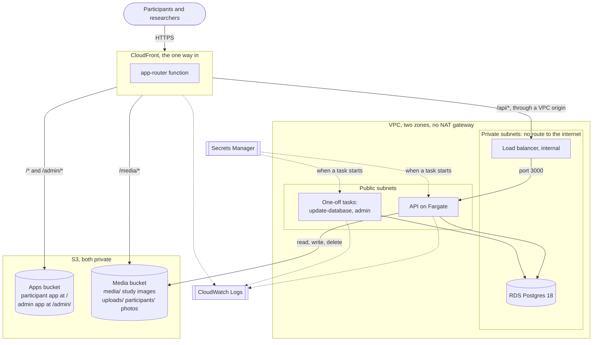

# Cloud architecture

How Truman 3 runs on AWS today. There are two stages: **staging**, which has no real participants, and **production**, in an account of its own ([Staging and production](#staging-and-production)). Where they differ, this page describes staging. Everything here is written in AWS CDK in `infra/`, so this page describes that code. [Deploying](guides/deploying.md) has the commands to run. [Architecture](architecture.md) describes the application itself.

Why it's built this way is in [ADR 19](adr/0019-how-truman-runs-in-production.md) (the container and static apps), [ADR 21](adr/0021-the-api-has-its-own-login-and-admin-lives-under-a-path.md) (two database logins, and admin under `/admin/`), [ADR 23](adr/0023-staging-runs-on-aws-from-cdk.md) (staging on AWS), and [ADR 25](adr/0025-participant-photos-go-through-the-api.md) (what participants upload).

## The files

| File                                | What it is                                                                                  |
| ----------------------------------- | ------------------------------------------------------------------------------------------- |
| `infra/bin/truman.ts`               | What `cdk` runs. Picks the stage, checks the apps are built, and reads `-c apiTasks`        |
| `infra/lib/stages.ts`               | Each place Truman runs, and what differs between them: `staging` and `production`           |
| `infra/lib/truman-stack.ts`         | Everything in one stack: network, database, buckets, CloudFront, the API, and one-off tasks |
| `infra/lib/app-router.js`           | A CloudFront Function that sends each app's paths to the right `index.html`                 |
| `infra/lib/run-database-update.cjs` | A Lambda function a deploy uses to update the database and wait for it (ADR 86)             |
| `infra/lib/truman-stack.test.ts`    | Checks the stack: what's reachable, where secrets go, what's logged, and what's kept        |
| `infra/cdk.json`                    | How `cdk` runs it, including `requireApproval: broadening`                                  |
| `.github/workflows/deploy.yml`      | Deploys staging on a merge into main, and production once a person approves (ADR 88)        |
| `scripts/deploy-from-ci.sh`         | What that workflow runs for each stage, and what it refuses to deploy                       |
| `Dockerfile`, `.dockerignore`       | The API's image                                                                             |

Building the stack asks AWS nothing. The account, region, zones, and CloudFront's prefix list are written in the code, so `pnpm --filter @truman3/infra synth` works with no credentials, and CI runs it.

## The whole picture



There's one address for everything. Staging has no domain of its own, so it's CloudFront's `*.cloudfront.net` address, printed as `Address` after a deploy.

## Networking

- **One VPC across two zones** (`us-east-1a` and `us-east-1b`). Each zone has a public subnet and a private one.
- **Private subnets have no route to the internet** at all. The load balancer and database are there.
- **There's no NAT gateway.** It would cost more than the API does. So the API's containers sit in a public subnet, with a public address, so they can reach AWS services and Prolific.
- **Firewalls (security groups) do the protecting:**

| Firewall           | Lets in                                | Notes                                                                                                         |
| ------------------ | -------------------------------------- | ------------------------------------------------------------------------------------------------------------- |
| `BalancerFirewall` | CloudFront's addresses, on port 80     | From AWS's prefix list for CloudFront (`pl-3b927c52` in us-east-1). No other outbound traffic than to the API |
| `ApiFirewall`      | Only the load balancer, on port 3000   | Used by the API and by the one-off tasks. A test checks nothing else gets in                                  |
| The database's     | Only `ApiFirewall`, on Postgres's port | So the API and the one-off tasks can reach it, and nothing else                                               |

**Why the zones are written down:** CloudFront can't reach a private load balancer in the zone `use1-az3`, and zone names like `us-east-1a` map to different zones in each AWS account. [Deploying](guides/deploying.md#before-the-first-deployment) says how to check them.

## CloudFront and how paths are routed

CloudFront holds the apps, the API, and media at one address, so cookies and links work the way ADR 19 and ADR 21 expect. It redirects HTTP to HTTPS everywhere.

| Path                   | Goes to                              | Cached      | Notes                                                                            |
| ---------------------- | ------------------------------------ | ----------- | -------------------------------------------------------------------------------- |
| `/api/*`               | The load balancer, then the API      | Never       | Every method. Passes all headers, cookies, and the query                         |
| `/media/*`             | The media bucket                     | Yes         | Study images. Adds security headers, since media shares an address with the apps |
| `/admin`               | Nothing: redirects to `/admin/`      |             | Done by `app-router.js`                                                          |
| `/admin/assets/*`      | The apps bucket                      | Yes, a year | The admin app's built files. Names change when contents do                       |
| Any other `/admin/...` | The apps bucket's `admin/index.html` | No          | So `/admin/studies/new` loads when opened directly                               |
| `/assets/*`            | The apps bucket                      | Yes, a year | The participant app's built files                                                |
| Anything else          | The apps bucket's `index.html`       | No          | So `/join/eatsnap` loads when opened directly                                    |

- **`/api/media/uploads/*`** is under `/api/*`, so what participants upload always goes through the API, which checks who's asking. CloudFront can't read `uploads/` in the bucket at all.
- **The router is a CloudFront Function, not custom error pages.** Error pages apply to the whole distribution, so they'd turn the API's real 403s and 404s into a web page.
- **The cache key for the apps leaves out the query,** so a recruitment ID in a study link never reaches S3.
- **CloudFront reaches the load balancer through a VPC origin,** a private connection into the VPC. That's why the load balancer needs no public address and no certificate. Traffic from CloudFront to it is HTTP, inside AWS.
- **Live updates stay open through CloudFront.** `/api/live` streams server-sent events for as long as a participant in a shared world has the page open (ADR 68). CloudFront waits up to 60 seconds for the API to send something, and the load balancer closes a connection after 60 seconds with nothing sent. The API sends a reminder every 15 seconds, so neither closes it.
- **Price class 100,** the cheapest set of CloudFront's locations.
- **Domains are optional.** A stage can list `domains` with a certificate in us-east-1. Staging has none.

## Storage buckets

Both buckets block all public access, are encrypted, and refuse requests that aren't HTTPS.

| Bucket | Holds                                                                                    | Who can read it                                                          |
| ------ | ---------------------------------------------------------------------------------------- | ------------------------------------------------------------------------ |
| Apps   | The two apps' built files. Participant app at the root, admin app under `admin/`         | CloudFront, through origin access control                                |
| Media  | `media/<hash>`: study images. `uploads/<world>/<participant>/`: what participants upload | CloudFront, only `media/*`. The API's task role: read, write, and delete |

- **A deploy copies the apps' files in two steps.** First `assets/`, cached for a year. Then `index.html`, marked not to cache, and CloudFront is told to drop its copy. So a browser never gets an `index.html` whose files aren't there yet.
- **Old built files are kept** (`prune: false`), for anyone who already has the page open.
- **Storage uses the container's role.** The API is given no S3 keys, so the AWS SDK finds credentials itself.

## The API and one-off tasks (ECS on Fargate)

The image is built from the repo's `Dockerfile` by `cdk deploy`, on the computer running it, for `linux/arm64`. It holds `apps/api`, `apps/cli`, `packages/*` except `ui`, and `studies/starters`. `.dockerignore` lists only what's needed, so `.env` can't get in. Node runs the TypeScript directly, and the image sets `NODE_ENV=production`.

One ECS cluster, `truman3-staging`, runs three task definitions from that image. Each is ARM64, with 1 vCPU and 2 GB on staging (`apiCpu`, `apiMemoryMb`). It was a quarter of that until a load test of 50 people in one shared world ran it flat out ([ADR 69](adr/0069-feeds-under-load.md)).

| Task definition                   | Runs                                                  | Database login | Secrets it gets                                  | Logs to                  |
| --------------------------------- | ----------------------------------------------------- | -------------- | ------------------------------------------------ | ------------------------ |
| `truman3-staging-api`             | `node apps/api/src/server.ts`, as a service           | `truman_app`   | App password, `TRUMAN_SECRET_KEY`, Anthropic key | `/truman3-staging/api`   |
| `truman3-staging-update-database` | `node packages/db/src/migrate-cli.ts`, by each deploy | `truman_owner` | Owner password, app password                     | `/truman3-staging/tasks` |
| `truman3-staging-admin`           | `node apps/cli/src/admin.ts`, by hand                 | `truman_app`   | App password                                     | `/truman3-staging/tasks` |

### The API service

- **`apiTasks` containers** run, one on staging. `-c apiTasks=0` on a deploy stops them.
- **In a public subnet with a public address,** behind `ApiFirewall`.
- **The load balancer** listens on port 80 and checks `/health/ready` every 30 seconds. That route answers only when the API can reach its database.
- **Deploys replace containers one by one.** A new container has to be healthy before the old one stops (minimum 100%, maximum 200%). If new ones keep failing, ECS rolls back to the last version that worked.
- **Its settings** are `DATABASE_HOST`, `DATABASE_PORT`, `S3_REGION`, `S3_BUCKET`, `MEDIA_PUBLIC_URL` and `PARTICIPANT_APP_URL` (both the CloudFront address), and `TRUSTED_PROXIES=2` (CloudFront, then the load balancer).

### The one-off tasks

- **A deploy runs the database update itself,** before it starts the new API (see [When a change includes a migration](#when-a-change-includes-a-migration)). The admin task is run by hand, with `aws ecs run-task`. A deploy prints the command for each, as `UpdateDatabaseCommand` and `AdminCommand`.
- **They use the API's subnets and firewall,** with a public address so they can pull the image and read secrets.
- **The database update is the only thing that gets the owner's login.**
- **The admin task creates teams and researchers.** The database has no route from outside, so this has to run inside. `pnpm admin setup` prints the first password, so the tasks' logs are kept for only one day.
- **Neither one-off task has storage settings.** On staging, studies are made, launched, exported, and withdrawn from in the admin app, not with `pnpm study`.

### How a container gets its database address

The app reads one setting, `DATABASE_URL`. Secrets Manager holds only the password, so each container's entry point puts the address together when it starts:

```
postgres://<login>:<password from a secret>@<DATABASE_HOST>:<DATABASE_PORT>/truman?sslmode=require
```

Storing a whole address as a secret would keep the password in two places, and one would go stale if it were changed. Generated passwords leave out characters that would need escaping in an address.

## The database

- **RDS for PostgreSQL 18**, `db.t4g.micro`, 20 GB of gp3 storage, in the private subnets.
- **One zone** (`multiAz: false`). This is set in the stack, not per stage.
- **Encrypted storage, and no public access.** Connections are encrypted (`sslmode=require`), but don't check the server's certificate. That needs the RDS certificate bundle in the image (ADR 23).
- **Automatic backups** (`backupDays`): 7 days on staging, 30 on production. A restore has been checked on both, with [Restoring from a backup](guides/restoring.md).
- **The database is called `truman`.**

### Logins and roles

ADR 21 explains why there are two.

| Login          | Made by                                                                                                     | Used by                    | Can                                                                                                                  |
| -------------- | ----------------------------------------------------------------------------------------------------------- | -------------------------- | -------------------------------------------------------------------------------------------------------------------- |
| `truman_owner` | RDS, when the database is created. Its password is in `truman3-staging/database-owner`                      | The database update only   | Everything. Owns the tables                                                                                          |
| `truman_app`   | The database update, the first time it runs, with the password from `truman3-staging/database-app-password` | The API and the admin task | Read and write rows. Only add to `events` and `assignments`. No changing tables, truncating, or turning off triggers |

- **After every migration, the update starts `truman_app`'s rights from nothing** and grants them again, so a new table is always covered (`packages/db/src/app-role.ts`). It also sets its password each time.
- **Two functions are the only ways `truman_app` can delete protected rows,** and both run with their owner's rights: `delete_participant_data` for a withdrawal, and `delete_study` for a study only test participants took part in (ADR 58).
- **The API won't start in production if it's logged in as an owner,** so a wrong setting shows up at once.

## Secrets

Each secret reaches a container by reference, when the container starts. None is ever a plain setting, and none is in the repo or a CloudFormation template.

| Secret                                  | Made by            | What it is                                                                                                | Given to                    |
| --------------------------------------- | ------------------ | --------------------------------------------------------------------------------------------------------- | --------------------------- |
| `truman3-staging/database-owner`        | The stack, for RDS | The owner's login, as JSON with a username and password                                                   | The database update         |
| `truman3-staging/database-app-password` | The stack          | `truman_app`'s password, 40 letters and numbers                                                           | The API, both one-off tasks |
| `truman3-staging/truman-secret-key`     | The stack          | `TRUMAN_SECRET_KEY`, 43 characters that read as 32 bytes of base64. Encrypts researchers' Prolific tokens | The API only                |
| `truman3-staging/anthropic-api-key`     | A person, by hand  | `ANTHROPIC_API_KEY`, so Christof's actors can write live with Claude                                      | The API only                |

- **The Anthropic key is made by hand** in the staging account, in us-east-1, so the key never passes through the repo or a deploy. The stage names it in `anthropicKeySecret`. Leave that out, and improvised beats use their fallback lines.
- **ECS reads secrets when a container starts.** Changing one means starting new containers. [Deploying](guides/deploying.md#the-claude-key) has the commands.
- **Changing `TRUMAN_SECRET_KEY` means every researcher connects Prolific again.**

## Logs

| Log group                | What                                                                                | Kept      |
| ------------------------ | ----------------------------------------------------------------------------------- | --------- |
| `/truman3-staging/api`   | The API's output                                                                    | Two weeks |
| `/truman3-staging/tasks` | The database update and the admin task, including a new researcher's first password | One day   |
| `truman3-staging-edge`   | CloudFront's access logs, as JSON                                                   | Two weeks |

- **Logs can't be cleaned when someone withdraws,** so they're kept short and hold as little as possible.
- **The API logs what kind of error happened and where,** never its message ([Deploying](guides/deploying.md#reading-production-logs)).
- **CloudFront's logs list the fields they keep** (`EDGE_LOG_FIELDS` in `truman-stack.ts`). Left out: the path and query (they can hold a username or a recruitment ID), the viewer's address, the referrer, and cookies. So a log says which part of the site failed, but not which page.
- **The load balancer keeps no logs,** since they'd hold whole addresses. A test checks this.

## What else the stack makes

- **An SES domain identity,** for email to researchers, if the stage has `mail` (ADR 72). Only the API's task role can send from it. Its DKIM records are outputs, to add where the domain's DNS is kept.
- **IAM roles.** The API's task role can read, write, and delete in the media bucket. Each task's execution role can pull the image, write its logs, and read its own secrets. CDK writes these from the code.
- **Small Lambda functions of CDK's own,** for copying the apps' files into their bucket and emptying buckets when the stack is removed.
- **Tags** on everything: `Project=truman3`, `Stage=staging`, and `RealParticipants=no`.
- **Outputs:** `Address`, `AdminAddress`, `UpdateDatabaseCommand`, `AdminCommand`, and, with `mail`, `MailDkimRecord1` to `3`.

## How a deploy works

Most deploys run from GitHub: a merge into main deploys staging, and production waits for a person to approve it ([Deploys from GitHub](#deploys-from-github)). A person can also deploy from `infra/`, with an AWS profile signed in, and has to for a change that adds permissions. [Deploying](guides/deploying.md#running-it-on-aws) has the exact commands. Either way, the steps are the same.

### A deploy, step by step

1. **`pnpm build`** at the repo's root builds both apps into `apps/*/dist`. `infra/bin/truman.ts` refuses to run without them.
2. **`pnpm run deploy --profile <profile>`** runs `cdk deploy --no-lookups`. CDK:
   - builds the stack into a CloudFormation template, asking AWS nothing
   - builds the API's image with Docker, and sends it to the image repository `cdk bootstrap` made
   - sends the apps' built files to the bucket `cdk bootstrap` made
   - stops to ask, if the change widens anyone's access (see below)
   - hands the change to CloudFormation, which updates each piece
3. **ECS starts the new API containers,** waits for the load balancer to call them healthy, and then stops the old ones.
4. **The apps' new files are copied,** `assets/` first, then each `index.html`, and CloudFront drops its copies of those.

### When a change includes a migration

A migration changes the database's tables. A deploy runs it for you, in the right order ([ADR 86](adr/0086-a-deploy-updates-the-database-itself.md)):

1. **The update's task gets the new image,** which has the new migrations in it.
2. **The deploy runs that task and waits.** A small function, `truman3-staging-run-database-update`, starts it and watches it. The old API keeps running the whole time.
3. **Then the new API starts,** on tables that are ready for it. Once it's healthy, the old one stops.

So one `pnpm run deploy` is enough, with or without a migration, and the API is never stopped.

- **If the update fails, the deploy fails,** and nothing else changes. The old API carries on with the old tables. CloudFormation's error says where the update's log is.
- **The update runs whenever the API's image changes,** migration or not. With nothing to do it takes about a minute. It also sets out `truman_app`'s rights again.
- **For a minute or two the old API runs on the new tables.** That's why a migration may only add things: a table, a column that can be empty or has a default, an index. `packages/db/src/migration-safety.test.ts` fails if a new migration drops, renames, or retypes something, or makes a column required.
- **To take something away, use two releases.** The first stops the code using it. The second, once the first is live, drops it.
- **Updating the database is safe to repeat.** Each migration runs once. `UpdateDatabaseCommand` still runs it by hand. Don't run two at the same time.

#### A migration that can't run under the old API

Sometimes two releases isn't worth it. Such a migration carries a line starting `-- stop-the-api:` with the reason, which the test accepts. To deploy it, stop the API first:

| Step                                                                | Why                                                                    |
| ------------------------------------------------------------------- | ---------------------------------------------------------------------- |
| 1. From the commit that's live now, `pnpm run deploy -c apiTasks=0` | Stops the API. The image hasn't changed, so the database isn't touched |
| 2. From the new commit, `pnpm run deploy`                           | Updates the database, then starts the new API on the new tables        |

The site is partly down in between: the apps still load, but `/api` has nothing behind it.

### Why some deploys ask for approval

`infra/cdk.json` sets `"requireApproval": "broadening"`. When a deploy would widen access, such as adding an IAM permission or a firewall rule that lets more in, `cdk deploy` shows the change and waits for someone to type `y`. Other deploys go ahead without asking.

- **This needs a person at a terminal.** A deploy that widens access can't run unattended, and the deploy from GitHub refuses one.
- **Read what it shows before saying yes.** An unexpected new permission is the thing to catch.

### Deploys from GitHub

`.github/workflows/deploy.yml` runs on every merge into main ([ADR 88](adr/0088-deploys-from-github.md)).

1. **Staging.** It runs the quick checks on the merged code, builds, and runs `scripts/deploy-from-ci.sh staging`.
2. **Production.** The job waits on the run's page, under **Review deployments**, until one of the `production` environment's reviewers approves. Then it builds and deploys the same commit.

GitHub holds no AWS keys. Each job gets a token from GitHub naming the repository and the environment it runs in. Each stage's stack has a role, `<stage>-deploy`, that only a job in this repository's `<stage>` environment can take, and both environments only run from main. The role can do nothing but take on the roles `cdk bootstrap` made.

The script refuses two kinds of change, and the run fails saying a person has to deploy it:

- **One that adds permissions or opens a firewall.** Deploy it from a terminal, read what it lists, and type `y`.
- **One with a migration marked `-- stop-the-api:`.** Follow [the two steps above](#a-migration-that-cant-run-under-the-old-api), and do it before merging anything else. The check only sees the commits in one push.

After a refusal, main is ahead of what's live until someone deploys by hand. The next merge's run then deploys as usual.

The logs are public, so the script keeps each stage's address and the stack's outputs out of them. To see the outputs, run `pnpm run diff` or look at the stack in the console.

**The environments are settings in GitHub, not code.** Under the repository's Settings, then Environments, `staging` and `production` should each allow deployments only from `main`, and `production` should list its required reviewers. Without reviewers, production would deploy on every merge. To check from a terminal:

```
gh api repos/<owner>/<repo>/environments/production --jq '.protection_rules'
```

## Staging and production

There are two stages, each in its own AWS account ([ADR 73](adr/0073-production-stage.md)):
- **`staging`**, in `truman3-staging`: for trying things, with no real participants.
- **`production`**, in `truman3-production`: for real participants, at `app.truman-research.org`.

The code has one switch for what happens to data: `holdsRealData`, on for production.

| With `holdsRealData`                          | Off (staging)                        | On                                                                                                   |
| --------------------------------------------- | ------------------------------------ | ---------------------------------------------------------------------------------------------------- |
| When removed: database, media bucket, secrets | Deleted, with their backups          | Kept                                                                                                 |
| Deletion protection on the database and stack | Off                                  | On                                                                                                   |
| Media bucket                                  | Not versioned                        | Versioned. Old versions expire after 7 days, so a deleted file doesn't outlast a withdrawal for long |
| Description and `RealParticipants` tag        | "For testing. No real participants." | "Holds real participants' data."                                                                     |

The apps bucket and the logs are deleted with the stack either way. They hold nothing that can't be made again.

Other settings in `Stage` are chosen per stage:
- zones, sizes, and `apiTasks`
- storage and backups
- the Anthropic secret
- domains, email, hosting, and alerts

Everything else in `truman-stack.ts` is the same for every stage, including the single-zone database and how long logs are kept.

**Production's extras:**
- **DNS:** truman-research.org's zone is in production, made by hand. The domain is registered in Social Design Lab's account, with its name servers pointing there. The stack adds `app.truman-research.org`, its certificate, and the email records. Staging's email records were added to the zone by hand.
- **Alerts:** eleven alarms and a monthly budget go to the SNS topic `truman3-production-alerts`. Six watch the API and the database from inside. Three ask the admin app, the participants' domain, and the site from outside AWS every 30 seconds, so a problem with DNS, a certificate, or CloudFront is noticed too. Two watch how much of Truman's email bounces or is marked as spam (ADR 87). Its email subscribers are added by hand, with the command in the `AlertsTopic` output.
- **Restoring:** [Restoring from a backup](guides/restoring.md) checks a restore works, and says how to replace the database.
- **The public site** ([ADR 75](adr/0075-the-public-site.md)): `site` adds `apps/site` at truman-research.org, from a bucket and a CloudFront distribution of its own. `site-router.js` gives pages clean addresses and sends www to the bare domain.
- **Participant domains** ([ADR 74](adr/0074-participant-domains.md)): `participantDomains` adds domains studies can run at. Each has its own zone, and they share the stage's certificate. The router answers 404 for the admin app and the admin API there. Production offers clikbrite.com, as the default.

**Before real participants,** [Deploying](guides/deploying.md#not-ready-yet) lists what's still missing.

## Removing it, and costing less

- **`-c apiTasks=0`** stops the API containers. Stopping the database by hand saves more, though RDS starts it again after 7 days.
- **The load balancer costs money while it exists.** Only removing the stack stops that.
- **`pnpm run destroy`** removes staging and everything in it. A stage with `holdsRealData` refuses until someone turns its protection off, and keeps its data.
